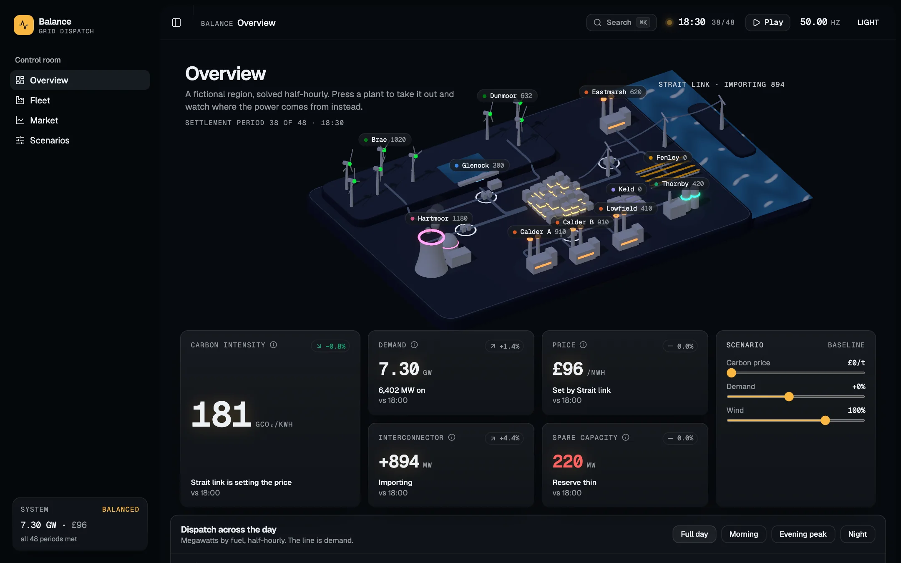
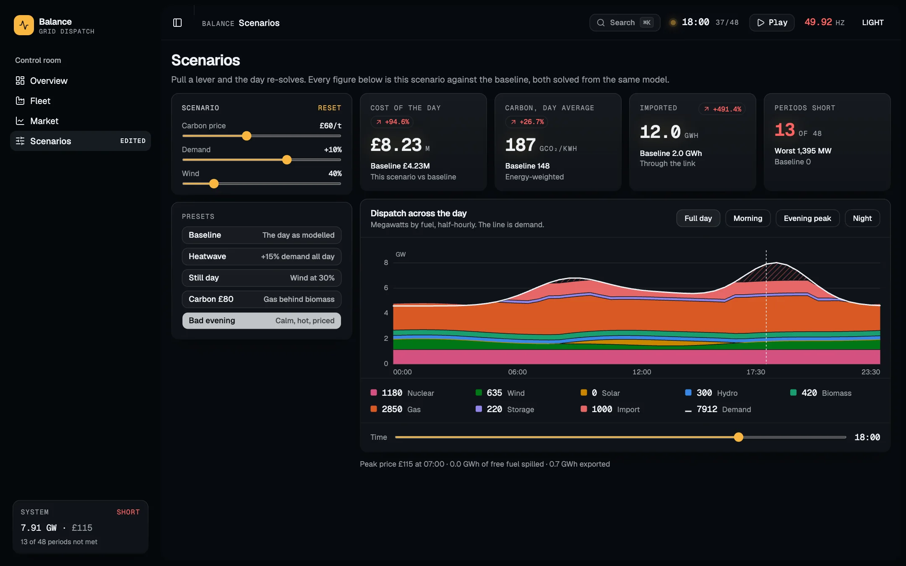
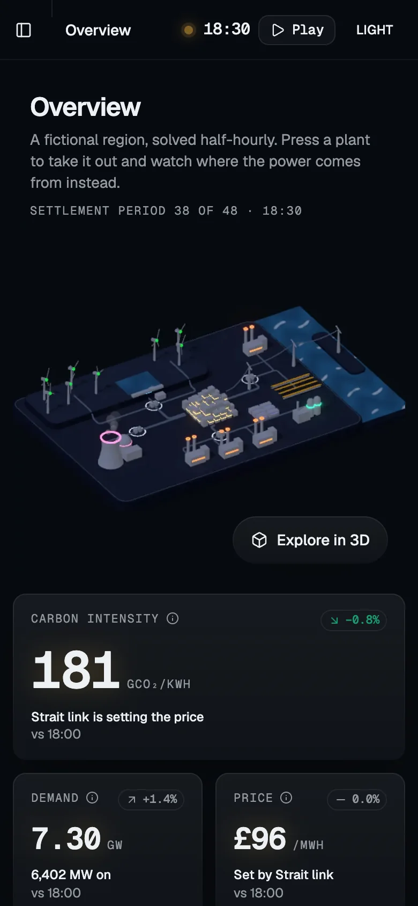
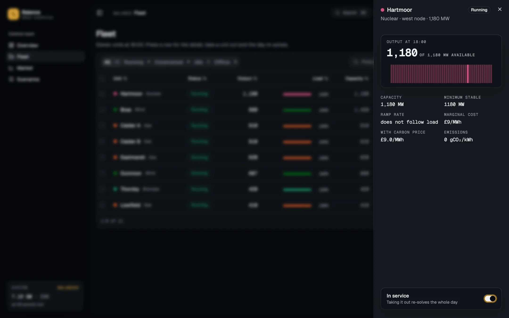
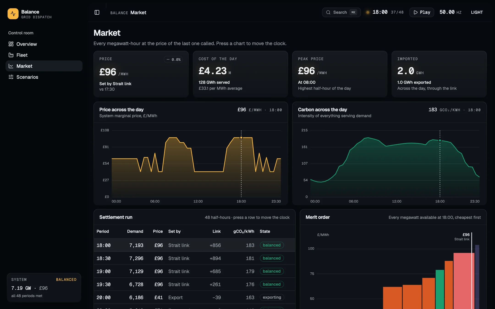
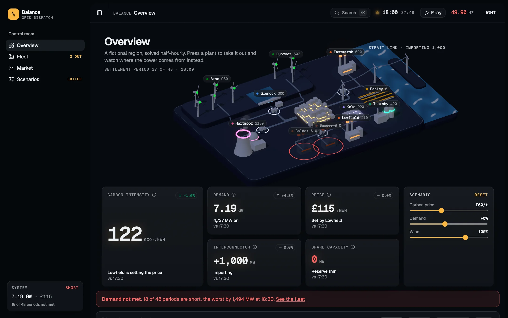
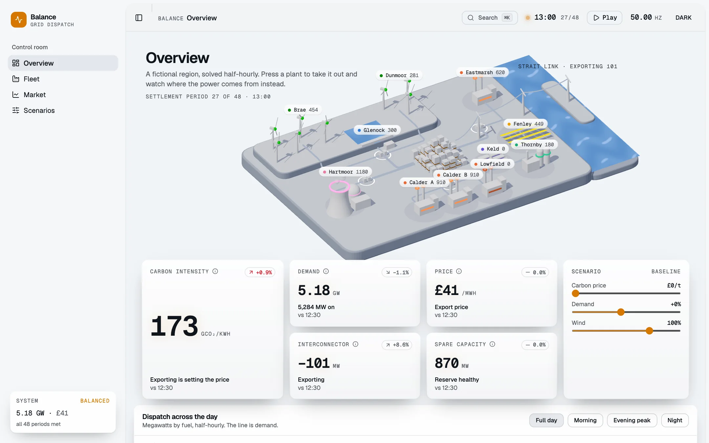

# Balance

A grid control room for a region that does not exist, solved half-hourly: an isometric model of the region where power visibly moves, built the way a product dashboard is built — a rail, four pages, a command palette, KPI cards, a table you can filter and page — where every number and every pulse of light is the output of one model.

**Live:** <https://balance-dispatch.pages.dev>



## In three seconds

- **Press a plant to take it out** and watch the power re-route: the cables dim and brighten, the link across the strait picks up, the price and the carbon move — on every page at once.
- **Pull three levers** (carbon price, demand, wind) or press a preset, and every figure is re-solved against the baseline. The state lives in the URL, so a scenario is a link.
- **One model, proven in the browser:** a merit-order dispatch with minimum stable generation, ramp rates and unit commitment; the browser suite re-solves the day and compares it with the text actually painted. Lighthouse mobile **88–90** on all four pages, accessibility 100.

---

## Challenge → solution → result

| The problem | What was built | Measured |
| --- | --- | --- |
| A data-dense dashboard reads as a spreadsheet | The region as an art-directed isometric model: plants sized by capacity and glowing with output, pulses along every cable at the solver's rate, the sun and the city's windows following the clock | The default view shows the data spatially, moving, with two levers in reach |
| Three megabytes of WebGL made a phone wait | A poster rendered from the scene itself shows before the app's JavaScript loads; a desktop fades the live model in on idle, a phone loads it when asked | Overview mobile score **37 → 90**, blocking time **2.5 s → 30 ms** |
| Every page shipped in one bundle | Fleet, market and scenarios load as routes; the command palette loads on first ⌘K | Fleet 88, market 89, scenarios 90 on mobile |
| Four pages could disagree with each other | Nothing is typed into a component; one solver feeds all of them, and the browser checks the painted text against a fresh solve | 20 Vitest tests on the model, 48 Playwright checks on a desktop and a Pixel 7, axe 0 violations |

<p>
  
  
</p>

## The one rule

Nothing is typed into a component. Every figure — the rail's status card, the masthead clock and frequency, the KPI trend badges, the stacked day, the supply curve, the settlement table, the events feed, and the width, count and speed of every particle in the scene — is derived from [`src/lib/grid/`](src/lib/grid), and the arithmetic has one invariant:

```text
generation + imports + unserved === demand + exports
```

to within 0.1 MW, in all forty-eight periods, under every lever, and still true with the two largest units out. That is the first test in [`dispatch.test.ts`](src/lib/grid/dispatch.test.ts), and it is the reason four pages can be trusted to agree with each other.

## The pages

**Overview.** The region as a model on a table, seen from one fixed isometric angle so it composes like an illustration rather than a game level: plants where they stand, sized by capacity and glowing with their output; power as pulses of light along the cables, as many as the megawatts call for and as fast as the plant behind them is working; the sun crossing with the clock, the city's windows coming up at dusk. Beneath it, the instruments: five KPI cards with a trend badge against the previous half-hour, the day stacked by fuel with a range control and a pointer readout, the system as a single-line diagram, and an events feed — every line of it a diff between two consecutive solves.

**Fleet.** The table every template has, built on TanStack Table, with the solver underneath it: tabs by status, search, a fuel filter, a column menu, row selection with a bulk action, sortable headers, status badges, a pager, and a drawer per unit with its day as a sparkline and the one switch that takes it out.



**Market.** Price and carbon across the day as two charts rather than one with two axes, the supply curve for the selected half-hour, and the settlement run paged twelve half-hours at a time — the statement a trading desk would reconcile against.



**Scenarios.** Three levers — carbon price, demand, wind — five presets worth pressing, and every figure against the baseline. Each comparison is two solves of the same model, nothing interpolated.

The view's inputs live in the URL — `?out=calder-a,calder-b&carbon=60&demand=1.1&wind=0.4&t=36` — so a scenario is a link somebody can send, and a reload is not a reset. Only inputs are stored, never a result.



## What the model actually does

A merit-order dispatch with the constraints that make the merit order interesting:

- **Minimum stable generation.** A thermal plant below its floor is not turned down, it is off. Committing one is a step change, not a slope.
- **Ramp rates.** Output can only move so fast per period, and the day is solved twice so that midnight is consistent with itself rather than starting cold.
- **Unit commitment.** Greedy, cheapest first, with must-run plant and free fuel on the system before the market is asked anything.
- **A constrained-on unit does not set the price.** At 04:00 both Calder stations are generating at £62 and £64 while the region is exporting at £41: they are running because they cannot shut down and restart inside half an hour, not because anybody is paying for them. The fleet table calls that state *constrained* and gives it its own tab.

The last of those arrived as a failing test. The test asserted that the price equals the cost of the dearest running plant, which is the intuition, and the model disagreed — biomass at £79 was on the system while the price was £71. The model was right and the test was the defect, which is the kind of result that only shows up when the model is real enough to argue with.

The levers found a second defect the baseline could not reach. With the link importing flat out and a thermal unit committed at its minimum stable output overshooting demand, the surplus branch wrote the export straight over the import — 1,000 MW vanished from the books. A £150 carbon price put gas behind the import, and the balance test failed in the first period. The link now gives back import before it exports, which is also what a control room does.

## The room

Dark by default, because the room it is modelled on is dark. Every surface is biased a few steps toward blue so the fuel colours sit on something with a temperature; every figure is set in a mono instrument face so the digits hold still as the clock runs; one amber means *live* and is used for nothing else. The light theme is designed rather than inverted.



The scene is [React Three Fiber](src/features/scene/RegionScene.tsx) and fetches nothing: the board, plants, city and cables are built in code, the colours read from the page's own stylesheet so the plants are exactly the hues the charts use, and bloom is on in the dark theme only. Until it runs, the stage shows a poster rendered from the same scene by `npm run posters` — one per theme and shape — which a boot shell in `index.html` paints before the app's JavaScript loads; where there is no WebGL the single-line diagram stands in. Its labels are ordinary DOM moved by a projector each frame rather than drei's portalled `<Html>`, which on React 19 removes a node its parent has already removed every time the page is left.

The fuel palette is checked rather than chosen: eight categorical hues validated for deuteranopia, protanopia and tritanopia separation, normal-vision separation and contrast against each theme's card surface. Four hues sit under 3:1 on their surface, which is why every series also has a labelled readout and a table.

## The checks

Twenty Vitest tests on the model, the readings derived from it and the scene layout. Forty-eight Playwright checks in [`e2e/`](e2e), run against the production bundle on a desktop and a Pixel 7 — including [`scene.spec.ts`](e2e/scene.spec.ts), which holds the poster on a phone until the visitor asks for the model.

The load-bearing one is [`figures.spec.ts`](e2e/figures.spec.ts). The rule above is that no number is typed into a component, and a unit test cannot see that — it can only check the solver, and the solver was never what was at risk. So the browser re-solves the day from the view's own inputs and compares the result against the text actually painted — on the overview and row by row on the fleet page, at rest, after the period changes, and with two units offline.

[`layout.spec.ts`](e2e/layout.spec.ts) measures the painted size of every piece of text inside every SVG at four widths and fails below 9px, because the dispatch chart once set its axis labels in viewBox units: 11px in the source, four pixels on a phone. [`shell.spec.ts`](e2e/shell.spec.ts) drives the rail, the palette, the table's tabs, search, column menu, selection, drawer and pager, the settlement run's pages and a scenario preset.

Three defects in the product that only the browser suite found, none of them in the specs: cmdk's input rendering outside cmdk's root inside the Base UI dialog, drei's labels tearing down a removed node on navigation, and Base UI's `DropdownMenuLabel` throwing outside a `DropdownMenuGroup` — the column menu was crashing the fleet page in production. **No check here is trusted until the bug it was written for has been put back**: typing a fixed `£96` into the price tile is invisible at 18:00, where £96 is the right answer, and fails the moment the period moves.

## Running it

Node 24 LTS.

```bash
npm install
npm run dev          # http://localhost:5173

npm run check        # typecheck, lint, Vitest, build
npm run qa           # builds, serves the bundle, runs the browser checks
npm run qa:dev       # the same checks against the dev server

npm run posters      # re-render the scene posters from the live model
npm run deploy       # builds and ships dist/ to Cloudflare Pages
```

`wrangler pages project create` now delegates to Cloudflare Workers, and on its way it rewrites `vite.config.ts` and `package.json` — the injected `cloudflare()` Vite plugin stops Vitest from starting. The project here was made with `--force`, which takes the classic Pages path; `npm run deploy` goes straight to it and changes nothing.

## Stack

Vite 8 · React 19.3 with the React Compiler · TypeScript 6 · Tailwind CSS v4 · shadcn/ui on Base UI · React Router 8 · TanStack Table 8 · three 0.186 / React Three Fiber 9.8 / drei / postprocessing · Motion 14 · cmdk · Vitest 5 · Playwright · Cloudflare Pages.

No charting library: every mark is an SVG path built from the solved periods, so the geometry and the figures cannot come from different places.

The region is fictional. The constraints are not.
