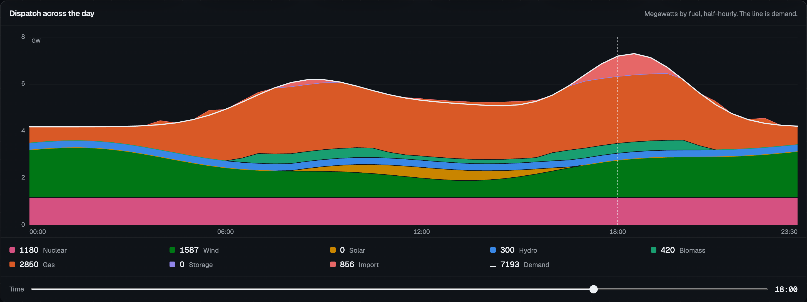
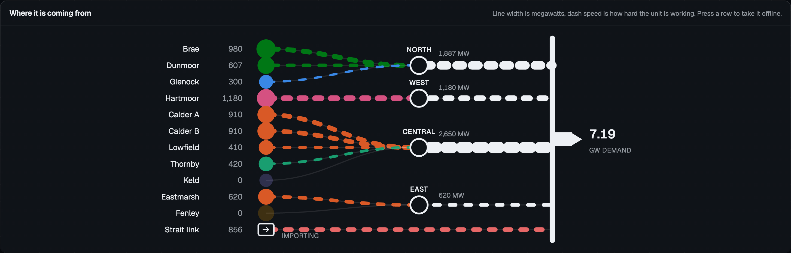

# Balance

A control room for a region that does not exist, solved half-hourly, where every number on the screen — and every particle moving across the map — is the output of one model.

Eleven generating units, four nodes, an interconnector and a city, dispatched across forty-eight settlement periods. Press **Play** and the day runs: the sun crosses the region, the solar farm wakes at nine, the city lights come up at dusk, and the instruments roll with the clock. Press a plant to take it out and the whole day re-solves — a dearer unit is called, the price moves, the carbon intensity moves with it, the particles feeding the city from the east thicken, and if the system can no longer meet demand the frequency droops and it says so.

**Live:** <https://balance-dispatch.pages.dev>


---

## The one rule

Nothing is typed into a component. Every figure — the tiles, the masthead clock and frequency, the stacked day, the supply curve, the diagram, the table, and the width, count and speed of every particle in the scene — is derived from [`src/lib/grid/`](src/lib/grid), and the arithmetic has one invariant:

```
generation + imports + unserved === demand + exports
```

to within 0.1 MW, in all forty-eight periods, under every lever, and still true with the two largest units out. That is the first test in [`dispatch.test.ts`](src/lib/grid/dispatch.test.ts), and it is the reason the rest of the room can be trusted to agree with itself.

## What the model actually does

Not a stacked chart with plausible numbers under it. A merit-order dispatch with the constraints that make the merit order interesting:

- **Minimum stable generation.** A thermal plant below its floor is not turned down, it is off. Committing one is a step change, not a slope.
- **Ramp rates.** Output can only move so fast per period, and the day is solved twice so that midnight is consistent with itself rather than starting cold.
- **Unit commitment.** Greedy, cheapest first, with must-run plant and free fuel on the system before the market is asked anything.
- **A constrained-on unit does not set the price.** At 04:00 both Calder stations are generating at £62 and £64 while the region is exporting at £41: they are running because they cannot shut down and restart inside half an hour, not because anybody is paying for them.

The last of those arrived as a failing test. The test asserted that the price equals the cost of the dearest running plant, which is the intuition, and the model disagreed — biomass at £79 was on the system while the price was £71. The model was right and the test was the defect, which is the kind of result that only shows up when the model is real enough to argue with.

### The levers

Three inputs to the same solver, each one a question a visitor might actually ask of a grid:

- **Carbon price**, £0–150 per tonne, charged on every unit in proportion to what it emits — gas at 352 g/kWh gains £17.60 per £50, nuclear and the renewables gain nothing — so the merit order re-sorts itself and the staircase slides into its new order on screen.
- **Demand**, −20% to +25%: a quiet Sunday or a heatwave, scaled before dispatch, never after.
- **Wind**, 20% to 130%: a still day or a front coming through.


The levers found a defect the baseline could not. With the link importing flat out and a thermal unit committed at its minimum stable output overshooting demand, the surplus branch wrote the export straight over the import — 1,000 MW vanished from the books. The baseline never reaches that state: only the battery sits behind the import in its merit order, and a battery has no minimum stable output. A £150 carbon price put gas behind the import, and the balance test failed in the first period. The link now gives back import before it exports, which is also what a control room does.

## The room

Dark by default, because the room it is modelled on is dark: a wall of instruments read from across a desk, where the surface recedes and the figures and the live marks carry the light. Every surface is biased a few steps toward blue so the fuel colours sit on something with a temperature; every figure is set in a mono instrument face so the digits hold still as the clock runs; one amber means *live* — the clock, the playhead, the ring on whatever has focus — and is used for nothing else. The light theme is designed rather than inverted.


**The region** is a [React Three Fiber](src/features/scene/RegionScene.tsx) scene that fetches nothing — three light panels baked once, a terrain of three sines, colours read from the page's own stylesheet so the plants are exactly the hues the charts use. Plants stand where they stand, sized by capacity and lit by their output. Power moves as particles: each line carries a count of them proportional to its megawatts, travelling at a speed set by how hard the plant behind them is working, so a nuclear station flat out and a battery flat out move at the same speed and are nothing like the same stream. Drag to orbit; a viewport-aware camera pulls back and widens the lens on a phone; where there is no WebGL the single-line diagram stands in.

**The clock** runs the day in 720 ms half-hours. Figures roll rather than jump, the dispatch bands slide to their new shape, the playhead glides, and the masthead carries the time, a live lamp and the system frequency — 50.00 Hz on a balanced system, derived from the solver's unserved demand and falling when it is short.





The fuel palette is checked rather than chosen: eight categorical hues validated for deuteranopia, protanopia and tritanopia separation, normal-vision separation and contrast against each theme's card surface, with a separate set of steps for the dark theme. Four hues sit under 3:1 on their surface, which is why every series also has a labelled readout and a table, and identity is never carried by colour alone.

## The checks

Eleven Vitest tests on the model. Thirty-three Playwright checks in [`e2e/`](e2e), run against the production bundle on a desktop and a Pixel 7.

The load-bearing one is [`figures.spec.ts`](e2e/figures.spec.ts). The rule above is that no number is typed into a component, and a unit test cannot see that — it can only check the solver, and the solver was never what was at risk. So the browser re-solves the day from the view's own inputs and compares the result against the text actually painted, in three states: at rest, after the period changes, and with two units offline.

[`layout.spec.ts`](e2e/layout.spec.ts) measures the painted size of every piece of text inside every SVG, at four viewport widths, and fails below 9px. It exists because the dispatch chart set its axis labels in viewBox units: 11px in the source, four pixels on a phone. That is not small type, it is no type, and it passed every other check there was.

[`levers.spec.ts`](e2e/levers.spec.ts) presses Play and watches the clock move, prices carbon and watches the system get dearer and no dirtier, stills the wind and watches the link take the strain.

**Neither of the first two was trusted until the bug it was written for had been put back.** Typing a fixed `£96` into the price tile is invisible at 18:00, where £96 happens to be the right answer, and fails the moment the period moves or a unit trips. Putting the merit curve back on a fixed canvas fails at 390px and nowhere else — which is exactly where that bug bites.

## Running it

Node 24 LTS.

```bash
npm install
npm run dev          # http://localhost:5173

npm run check        # typecheck, lint, Vitest, build
npm run qa           # builds, serves the bundle, runs the browser checks
npm run qa:dev       # the same checks against the dev server

npm run deploy       # builds and ships dist/ to Cloudflare Pages
```

`wrangler pages project create` now delegates to Cloudflare Workers, and on its way it rewrites `vite.config.ts` and `package.json` — the injected `cloudflare()` Vite plugin stops Vitest from starting. The project here was made with `--force`, which takes the classic Pages path; `npm run deploy` goes straight to it and changes nothing.

## Stack

Vite 8 · React 19.3 with the React Compiler · TypeScript 6 · Tailwind CSS v4 · shadcn/ui on Base UI · React Router 8 · three 0.186 / React Three Fiber 9.8 / drei · Motion 14 · Vitest 5 · Playwright · Cloudflare Pages.

No charting library: every mark is an SVG path built from the solved periods, so the geometry and the figures cannot come from different places.

The region is fictional. The constraints are not.
